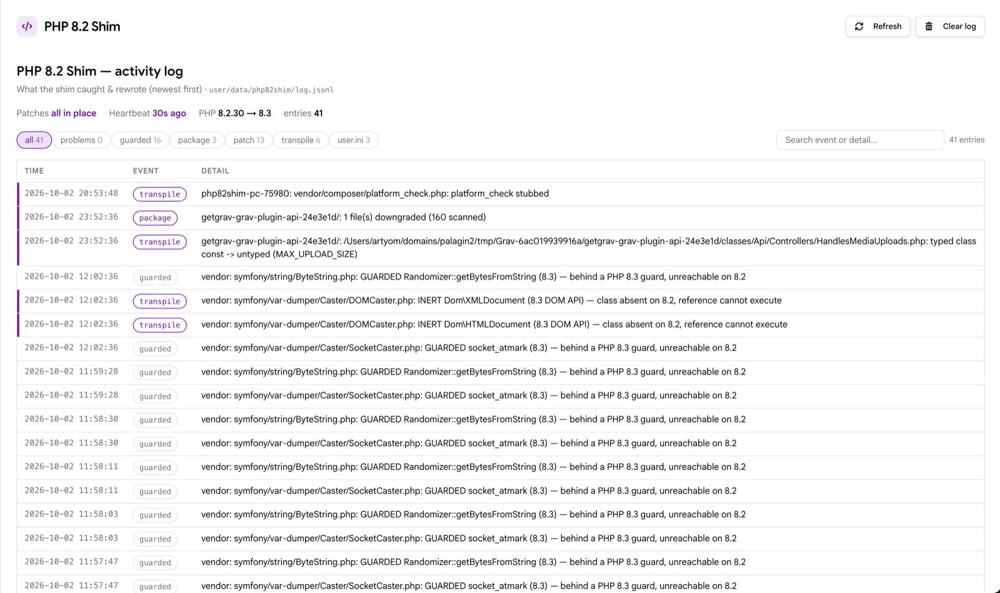

Русский | [English](README.md)

# Плагин PHP 8.2 Shim

Позволяет запускать сайт на Grav 2 на shared-хостинге с PHP 8.2, где PHP 8.3 недоступен. Плагин ослабляет проверки версии в ядре Grav и транспайлит 8.3-синтаксис в устанавливаемых пакетах до PHP 8.2 — с блокировкой опасных обновлений и видимым логом активности.



## Что делает

- **Ослабляет гейты версии**:
  - Проверки минимальной версии в `index.php`/`system/`, `platform_check.php` от Composer и `require.php` в корневом `composer.json`.
  - Перехват GPM `Installer`/`Upgrader` — обновления проходят через шим до публикации.
- **Транспайлит пакеты при установке**:
  - Типизированные константы классов, `new readonly class`, `Class::{$expr}` и прочий 8.3-синтаксис переписывается в 8.2-эквивалент до того, как пакет попадает в продакшн.
  - Работает для плагинов, тем и обновлений ядра Grav.
- **Полифиллы** недостающих функций 8.3 (`json_validate`, `mb_str_pad`, `str_increment`/`str_decrement`, `stream_context_set_options` и другие).
- **Самолечение после обновлений ядра**:
  - Bootstrap через `auto_prepend_file` заново накатывает патчи при следующем запросе, если апдейт заменил пропатченные файлы.
  - Heartbeat-маркер подтверждает, что prepend реально исполняется на вашем SAPI (LiteSpeed/cPanel могут молча игнорировать `.user.ini`).
- **Fail-closed**:
  - Если якорь патча дрогнул после изменений апстрима, обновления блокируются до выхода новой версии шима — страница в админке показывает, какие файлы не пропатчились.
  - Пакеты с конструкциями, которые шимить нельзя, отклоняются при включённом `block_unshimmable` (по умолчанию включён).
- **Страница лога в админке**:
  - Сайдбар → **PHP 8.2 Shim**: лог с поиском и фильтрами, здоровье патчей, статус heartbeat.
  - Английский и русский интерфейс.

## Требования

- Grav **2.x** (указано в `compatibility` в `blueprints.yaml`).
- PHP **8.2.x** — реальный рантайм. На нативном PHP 8.3+ шим самоотключается, плагин можно выключить.
- SAPI, который читает `.user.ini` (CGI/FastCGI; на LiteSpeed нужен `lsapi_enable_user_ini`). Apache `mod_php` `.user.ini` игнорирует — heartbeat на странице лога покажет, если prepend не работает.

Успешно протестировано на Grav **2.2.x** и PHP **8.2.30**.

## Установка

Плагин **переписывает файлы ядра Grav на месте** — сделайте бэкап или проверьте на стейджинге.

1. Положите плагин в `user/plugins/php-82-shim`.
2. Из корня Grav один раз запустите bootstrap:

   ```bash
   php user/plugins/php-82-shim/bin/bootstrap.php
   ```

   Он сканирует и транспайлит существующее дерево, пишет managed-блок в `.user.ini` и проверяет stub для prepend.

3. Откройте **Админка → PHP 8.2 Shim** — `Patches: all in place` и свежий heartbeat означают, что всё работает. PHP перечитывает `.user.ini` не чаще, чем раз в `user_ini.cache_ttl` секунд (по умолчанию 300с) — на нагруженном хостинге подождите пару минут.

## Стоит знать

- `bin/gpm` и cron идут через CLI, где `auto_prepend_file` не работает. Персистентные патчи файлов защищают обновления и там, но heal-on-request — механика только веб-SAPI; при сомнениях перезапустите `bin/bootstrap.php`.
- Транспайлер — **best-effort, а не доказательство совместимости**. Известные расхождения: типизированные константы теряют runtime-проверку типа, `new readonly class` теряет readonly-семантику, `__clone` с переинициализацией readonly-свойств всё ещё фаталит на 8.2, а `catch` по `DateMalformed*`-исключениям не сработает (ext-date в 8.2 их не бросает).
- **Удаление**: `bin/gpm uninstall` и `bin/uninstall.php` откажутся работать, пока рантайм — PHP 8.2: без шима пропатченные гейты продолжат принимать 8.3-пакеты, которые не исполнятся. На PHP 8.3+ удаление отчищает блок в `.user.ini`, хук в `composer.json` и состояние плагина (stub-файл prepend остаётся — PHP-кэш ini может ссылаться на него ещё несколько минут).
- Правильное долгосрочное решение — хостинг с PHP 8.3+; плагин существует для сценария «много проектов на одном 8.2-only шареде».

## Благодарности

Реализации `str_increment`/`str_decrement`, `mb_str_pad` и `json_validate` в `classes/Php82Shim/polyfill.php` портированы дословно из [symfony/polyfill-php83](https://github.com/symfony/polyfill) (MIT, © Fabien Potencier / Symfony contributors).
